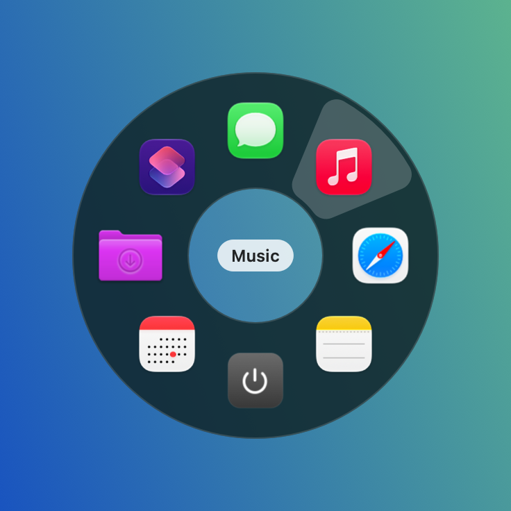

# PieMenu

**A radial menu at your pointer: press ⌃Tab, click a slice. It opens apps, files, folders, Automator workflows, Shortcuts and shell commands.**

[Español](README.es.md) · macOS 13+ · Apple Silicon & Intel · MIT licence · no network, no accounts

<p align="center"></p>

A free, open-source take on hotkey pie menus. Put the things you launch all day on up to eight slices and reach any of them with a shortcut and a click, without leaving the app you're in.

- **Click to run**: press ⌃Tab and the menu opens around the pointer; click a slice to run it. Hovering only highlights it, so nothing runs by accident.
- **Cancel**: Esc, ⌃Tab again, a click in the centre or anywhere outside the menu.
- **While it's open**: ⌘, opens Settings. Right-click a slice to open it, edit it, show it in Finder or remove it; right-click the centre to add a slice or open Settings.
- **What a slice can do**: open an app, file or folder (Automator apps included), run an Automator `.workflow`, run a Shortcuts shortcut by name, or run a shell command.
- **Native look**: a dark glass ring like the system HUDs, real app icons, the hovered slice's name in the centre. The app you were using keeps focus.
- **Configurable hotkey** (default ⌃Tab), optional **menu bar icon** and **open at login**, Spanish/English.

## Install

| Method | Best for | |
|---|---|---|
| **[Installer `.pkg`](https://github.com/jdevesablanco/PieMenu/releases/latest/download/PieMenu.pkg)** | Easiest: double-click, no Terminal | Direct download |
| **[Disk image `.dmg`](https://github.com/jdevesablanco/PieMenu/releases/latest/download/PieMenu.dmg)** | Drag the app to *Applications* | Direct download |
| **Homebrew** | Terminal users | `brew install --cask jdevesablanco/tap/piemenu` |
| **From source** | Developers | `git clone … && Scripts/install.sh` |

Clicking a download link starts the download straight away (latest release). All versions: [Releases](https://github.com/jdevesablanco/PieMenu/releases).
The app is ad-hoc signed, not notarized by Apple, so the first time: *System Settings → Privacy & Security → Open Anyway* (on macOS 13–14, right-click → *Open* also works), or `xattr -dr com.apple.quarantine /Applications/PieMenu.app` (see [docs/NOTARIZATION.md](docs/NOTARIZATION.md)).

**From source** (Xcode Command Line Tools):

```bash
git clone https://github.com/jdevesablanco/PieMenu && cd PieMenu
Scripts/install.sh   # builds, copies the app to /Applications and opens it
```

PieMenu has no Dock icon: look for ◎ in the menu bar. Click it → **Settings…** to set up your slices. You can hide the icon in *Settings → General*; the hotkey keeps working, and opening PieMenu again (Spotlight, Launchpad, *Applications*) brings Settings back.

## Slices

Each slice has a name, an icon (an SF Symbol, or leave it empty to use the file's own icon) and an action:

| Action | Target | How it runs |
|---|---|---|
| Open | App, file, folder or Automator app | Like double-clicking it in Finder |
| Open | Automator `.workflow` | `/usr/bin/automator <file>` (opening it would only show it in Automator) |
| Run shortcut | The shortcut's name (pick it from the list) | `/usr/bin/shortcuts run <name>` |
| Run shell command | A command | `/bin/zsh -lc <command>`, with your login `PATH` |

From 1 to 8 slices, starting at 12 o'clock and going clockwise. Reorder them with the arrows in *Settings → Slices*. If an action fails, PieMenu tells you why.

**Tip:** an Automator app or a shortcut can do several things at once, like opening the three apps you use for a project or quitting everything. Put it on a slice and that whole routine is one click away.

## Limitations

- The global hotkey uses `RegisterEventHotKey`, so it needs no Accessibility permission and the frontmost app never sees the keys. While PieMenu runs, ⌃Tab no longer switches tabs in browsers; pick another hotkey in *Settings → General* if you need it.
- If another app already owns the same hotkey (another pie menu app, for example), PieMenu says so in *Settings → General*.
- Automator apps and shortcuts that control other apps may trigger their own macOS permission prompts the first time. That's between them and macOS.

Settings live in `~/Library/Application Support/PieMenu/config.json`.

## Privacy

Everything runs on your Mac. No telemetry. The only network access is when *you* press **Install** on one of the pack's apps (GitHub's public API / Homebrew).

## Pairs well with

Made by the same author, free and open source:

| App | What it does | Status |
|---|---|---|
| [SplitExercises](https://github.com/jdevesablanco/SplitExercises) | Splits exercise PDFs into one sheet per exercise, from the right-click menu | Available |
| [QuitAll](https://github.com/jdevesablanco/QuitAll) | Quits every app in one click, except the ones you pick | Available |
| **PieMenu** | A radial menu at the pointer with your apps, shortcuts and Automator | This app |

The app shows the same cards in *Settings → Pairs well with*, detects which ones you have and installs the rest with Homebrew or the latest `.pkg` from GitHub.

## Development

- `Sources/PieMenu`: SwiftUI/AppKit menu bar app (hotkey, pie panel, actions, settings). `PackCatalog.swift` is shared verbatim by every app of the pack.
- `PIEMENU_SELFTEST=1 build/PieMenu.app/Contents/MacOS/PieMenu` drives the pie with a simulated pointer and keys, off screen, and checks that hovering never runs a slice and clicking does (no real input, safe while you work).
- `PIEMENU_CONFIG_DIR=/dir` isolates settings; `PIEMENU_SNAPSHOT=/dir build/PieMenu.app/Contents/MacOS/PieMenu` renders the pie to PNG and quits (a dark tint stands in for the live glass blur).
- `Scripts/build-app.sh` builds `build/PieMenu.app`; `Scripts/make-dmg.sh` and `Scripts/make-pkg.sh` package it; `Scripts/install.sh` installs it into `/Applications`.
- Releases: `Scripts/release.sh X.Y.Z` tags and pushes; GitHub Actions builds the universal app and attaches the DMG and PKG to the release.

## License

MIT © 2026 Julio Devesa Blanco
